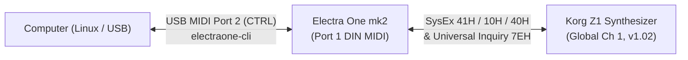

# Korg Z1 MOSS Synthesizer — Electra One mk2 User Manual

Welcome to the user manual for the **Korg Z1 MOSS Synthesizer** editor preset suite on the **Electra One mk2** (Firmware `v5.0+`, Lua `5.4`).

This preset suite provides **100% parameter coverage** of the Korg Z1 Program architecture (`PROG_PRM.TXT`: all **953** active parameter IDs / **1,257** addressable parameters across `ExID 0..5`), complete with dynamic oscillator model switching, dynamic effect algorithm switching, custom graphical widgets (LFO wave shapes, Mixer bus bar-graphs, DX7-style 8-stage envelopes, LCD Program Name & Z1 Status displays, and Signal Flow visualization), automatic **Patch Backup & Recovery**, and a **Snapshot-backed Undo/Redo buffer**.

> [!NOTE]
> **Media Placeholders:** Dedicated callouts (`[Screenshot Placeholder]` / `[Video Placeholder]`) are included throughout this manual and its page guides so screenshots and short demonstration videos can be dropped into `usermanual/media/` as they are recorded.

---

## Table of Contents

1. [Project History & Milestones](#1-project-history--milestones)
2. [Hardware & MIDI Setup](#2-hardware--midi-setup)
3. [Base Features (`e1/z1-base`)](#3-base-features-e1z1-base)
   - [3.1 Z1 Device Inquiry & Handshake](#31-z1-device-inquiry--handshake)
   - [3.2 Current Program Dump Request (`10H` $\rightarrow$ `40H`)](#32-current-program-dump-request-10h--40h)
   - [3.3 Program Name Display & 16-Character Editor](#33-program-name-display--16-character-editor)
   - [3.4 Always-On E1 Patch Backup & `Recover Backup`](#34-always-on-e1-patch-backup--recover-backup)
   - [3.5 Snapshot-Backed Undo & Redo Buffer](#35-snapshot-backed-undo--redo-buffer)
4. [Template Pages & Navigation Guide](#4-template-pages--navigation-guide)
5. [Electra One Bank & Slot Map](#5-electra-one-bank--slot-map)
6. [Korg Z1 SysEx Protocol Summary](#6-korg-z1-sysex-protocol-summary)
7. [Developer & Verification Utilities](#7-developer--verification-utilities)

---

## 1. Project History & Milestones

Derived from the repository history (`9cd5c4a Initial commit: Z1 SysEx verification and Electra One OSC1 dynamic preset` through the full Phase 2–6 module rollout and `z1-base` implementation):

1. **Phase 1 — Hardware SysEx Verification (`Z1_SysEx.md`):**
   - Verified Korg Z1 Model ID (`0x46`), Universal Device Inquiry (`F0 7E 0g 06 01 F7` $\rightarrow$ `42 46 00 01 00`, firmware `v1.02`), Current Program Dump Request (`10H` $\rightarrow$ 666-byte `40H` response unpacking to 576 bytes of 8-bit program data), 14-bit LSB-first Parameter Change (`41H`), `ExID` bit-packing (`(ExID << 11) | ID`), and 14-bit two's-complement negative value encoding.
2. **Phase 2 — Dynamic Oscillator 1 Editor (`e1/z1-osc1`):**
   - Implemented dynamic switching across all **13 Z1 OSC1 Physical & Synthesis Models** (`Standard`, `Comb`, `VPM`, `Resonance`, `Ring Mod`, `Cross Mod`, `Sync`, `Organ`, `Brass`, `Reed`, `Plucked String`, `Bowed String`, `Electric Piano`, `ExID = 1`, IDs `464..754`).
3. **Phase 3 — Interactive Envelopes (`e1/z1-eg`):**
   - Implemented 5 graphical `dx7envelope` widgets (`EG1`–`EG4` + `Amp EG`) with dedicated `Start Level` faders, persistent `Amp EG` modulation controls, and a `Reveal Modulations` toggle with an `EG Target` selector for `EG1`–`EG4`.
4. **Phase 4 — Dual Multi-Mode Filters (`e1/z1-filter`):**
   - Implemented `Filter Routing` (`Serial`, `Parallel`, `Indiv`), `Filter Link`, `EG Knob Target` (`ID 260`), a dynamic **Assigned Cutoff EG** widget that automatically tracks the selected filter's assigned EG (`EG1`–`EG4` / `Amp EG`), and conditional **Band-B (`2BPF`)** controls that appear only when `2BPF` is selected.
5. **Phase 5 — Quad LFOs with Custom Waveform Graphics (`e1/z1-lfo`):**
   - Implemented `LFO1`–`LFO4` with real-time custom Lua canvas waveform visualizers rendering all **18 Z1 LFO wave shapes**, `Offset` vertical shift, and `Fade-In` envelope ramps, plus MIDI Tempo Sync and Frequency/Amplitude modulation.
6. **Phase 6 — Complete Synthesis, Effects & Performance Suite:**
   - **Mixer (`e1/z1-mix`):** 5 channel strips (`OSC1`, `OSC2`, `SUB`, `NOISE`, `FEEDBACK`) feeding `Filter 1` (`Out 1`) and `Filter 2` (`Out 2`) with custom bus bar-graph meters.
   - **OSC 2 (`e1/z1-osc2`):** All **9 OSC2 Models** (`ExID = 2`, IDs `464..615`) plus a toggleable `OSC2 VIEW` (`Model Params` vs. `Pitch & Mod`).
   - **Sub & Noise (`e1/z1-sub-noise`):** Sub Oscillator, Noise Generator with dedicated filter, Pitch Bend, Common Pitch Modulation, and Portamento.
   - **Amp, Output & Performance Editor (`e1/z1-mod`):** `Amp 1`, `Amp 2`, `Output/Pan`, `OSC1 Core Pitch/Mod`, and all **5 Performance Editor Knobs (`PE Knob 1..5`, 80 parameters)**.
   - **Effects, EQ & FX Preset Manager (`e1/z1-fx`):** Dynamic `FX1` (15 algorithms, `ExID = 3`), `FX2` (11 algorithms, `ExID = 4`), `Master FX` (3 algorithms, `ExID = 5`), 2-Band EQ, and persistent FX Preset Save/Recall.
   - **Program Common, Controllers & Link Arpeggiator (`e1/z1-common-arp`):** Category, Poly/Mono/Unison, Scale, Assignable Switches/Pedals, Link Arpeggiator, and Program Name editor.
   - **Signal Flow Visualizer (`e1/z1-signalflow`):** Custom signal chain diagram showing active/inactive blocks, serial/parallel routing, and the post-amp feedback loop.
7. **Phase 7 — Parameter Coverage Audit & Base Utility (`check-params.lua`, `e1/z1-base`):**
   - Verified **100.0% (`953/953` IDs, `1,257/1,257` addressable `ExID` parameters)** in `PROG_PRM.TXT`.
   - Built `e1/z1-base` with Handshake, `40H` Patch Request, 7-to-8-bit Korg pack/unpack, automatic Patch Backup & `Recover Backup`, and Snapshot-backed `Undo` / `Redo`.

---

## 2. Hardware & MIDI Setup



### Required Korg Z1 Settings (`GLOBAL` / `MIDI` Mode)
1. **Global MIDI Channel:** Set to **Channel 1** (or match the Device 1 channel configured on the Electra One).
2. **SysEx Receive (`MIDI Filter`):** Set **Exclusive = ENA (Enable)** so the Z1 accepts `41H` Parameter Change and `40H` Program Dump messages.
3. **SysEx Transmit:** Set **ENA (Enable)** if you want knob/button movements and program changes on the Z1 front panel to transmit SysEx to the Electra One.
4. **Memory Protect:** Turn **Internal Program Protect = OFF** only when executing Program Write (`11H`) operations.

---

## 3. Base Features (`e1/z1-base`)

The **Base & Utility** module ([`e1/z1-base/`](../e1/z1-base/)) provides the foundational communication, patch name management, patch protection, and history features shared by the preset suite.

> 📸 **[Screenshot Placeholder: `usermanual/media/base-overview.png`]**
> *Add photo/screenshot of the Electra One displaying the `Base: Handshake & Patch Name` page.*
>
> 🎬 **[Video Placeholder: `usermanual/media/base-backup-undo.mp4`]**
> *Add short video demonstrating Patch Request (`40H`), editing the Program Name, Undo/Redo, and Recover Backup.*

### Control Layout (`e1/z1-base`)

| Row | Slot(s) | Control ID | Name | Type | Function |
|:---:|:---:|:---:|---|---|---|
| **1** | 1 | `1` | **Handshake ID** | Momentary Pad | Sends Universal Device Inquiry (`F0 7E 0g 06 01 F7`) and verifies Z1 connection & firmware version. |
| **1** | 2 | `2` | **Patch Req 40H** | Momentary Pad | Backs up current E1 patch, then sends Current Program Dump Request (`F0 42 3g 46 10 00 F7`). |
| **1** | 3–4 | `3` | **Z1 Status** | Custom Display | Line 1: Online/Offline state, Global Channel, Z1 Firmware (`v1.02`), and last dump status.<br>Line 2: Active Backup patch name (`Bk: <Name>`). |
| **1** | 5 | `4` | **Recover Backup** | Momentary Pad | Restores the backed-up patch on the E1 **and** transmits the full `40H` dump (or `41H` name params) back to the Z1 edit buffer. |
| **1** | 6 | `7` | **Backup Now** | Momentary Pad | Manually snapshots the current E1 patch into the Backup slot (`patchBackup` + E1 Snapshot Bank 12 Slot 36). |
| **2** | 1 | `33` | **Name Pos** | Fader (`1..16`) | Selects the cursor position (`1..16`) within the 16-character Z1 Program Name. |
| **2** | 2 | `34` | **Name Char** | Fader (`32..127`) | Edits the ASCII character (`' '` to `'~'` / `DEL`) at `Name Pos` and sends `41H` Parameter Change (`ID 1..16`) to the Z1. |
| **2** | 3–4 | `35` | **Program Name** | Custom Display | Line 1: Selected cursor position (`P01..P16`), character preview, and Undo stack position (`U:cursor/total`).<br>Line 2: Full 16-character Program Name. |
| **2** | 5 | `5` | **Undo** | Momentary Pad | Steps backward in the Undo buffer (E1 Snapshot Bank 12 Slots `1..16`) and updates both the E1 and Z1. |
| **2** | 6 | `6` | **Redo** | Momentary Pad | Steps forward in the Redo buffer (E1 Snapshot Bank 12 Slots `1..16`) and updates both the E1 and Z1. |

---

### 3.1 Z1 Device Inquiry & Handshake
Pressing **Handshake ID** sends the Universal Non-Realtime Device Inquiry request:
```text
F0 7E 0g 06 01 F7
```
When the Korg Z1 replies with its 15-byte Identity message (`F0 7E 0g 06 02 42 46 00 01 00 mnL mnM mjL mjM F7`), the E1 verifies Family ID `0x0046` (Korg Z1) and updates the **Z1 Status** widget with the Z1's Global MIDI Channel and OS version (e.g., `Z1 Ch1 v1.02`).

### 3.2 Current Program Dump Request (`10H` $\rightarrow$ `40H`)
Pressing **Patch Req 40H** requests the active Program Edit Buffer from the Korg Z1:
```text
F0 42 3g 46 10 00 F7
```
The Z1 responds with a **666-byte** `40H` Current Program Data Dump (`F0 42 3g 46 40 01 [659 packed bytes] F7`). The Lua engine unpacks all **659** 7-bit MIDI bytes into the **576** internal 8-bit Z1 program bytes (`currentUnpackedProgram`) and extracts bytes `1..16` into the **Program Name** widget without echoing SysEx back to the Z1.

### 3.3 Program Name Display & 16-Character Editor
- **Program Name (`IDs 1..16`, `ExID = 0`):** Occupies the first 16 unpacked bytes of the Z1 Program data (`0x20` Space through `0x7F`).
- Use **Name Pos** (`1..16`) to highlight any character slot, and turn **Name Char** (`32..127`) to change the character in real time via Z1 Parameter Change (`F0 42 3g 46 41 01 idL 00 char 00 F7`).

### 3.4 Always-On E1 Patch Backup & `Recover Backup`
To prevent losing your work on the Electra One if you accidentally trigger a Patch Request (`10H`) or receive a `40H` dump from the synth that wipes out your current edits:
1. **Automatic Pre-Request & Pre-Dump Backup:** Every time you press **Patch Req 40H** or before an incoming `40H`/`4CH` dump is applied, the E1 automatically saves the current patch state (`programNameChars` + full 576-byte `currentUnpackedProgram`) into `patchBackup` **and** saves the control values into **Electra One Snapshot Bank 12, Slot 36**.
2. **Manual Backup (`Backup Now`):** Press **Backup Now** (Control `7`) at any time to checkpoint your current patch into the backup slot.
3. **One-Button Recovery (`Recover Backup`):** Press **Recover Backup** (Control `4`) to immediately restore the backed-up patch on the E1, reload Snapshot `(12, 36)`, repack the 576-byte program buffer into a 666-byte `40H` Current Program Dump, and transmit it back to the Korg Z1 edit buffer.

### 3.5 Snapshot-Backed Undo & Redo Buffer
- The preset uses **Electra One Snapshot Bank 12, Slots `1..16`** alongside an in-memory Z1 program history ring buffer (`undoStack`, `MAX_UNDO_SLOTS = 16`).
- Every patch load or edit pushes a state onto the Undo stack and writes a labeled snapshot (`U01:<Name>` .. `U16:<Name>`) to Bank 12.
- Pressing **Undo** (Control `5`) or **Redo** (Control `6`) loads the corresponding snapshot slot, updates the E1 displays (`U:cursor/total`), and transmits the restored patch state back to the Korg Z1.

---

## 4. Template Pages & Navigation Guide

Click any page guide below for detailed documentation of its controls, dynamic behavior, custom widgets, and Korg Z1 parameter mappings:

| # | Page Guide | Source Folder | Parameters Covered | Key Features & Custom Widgets |
|:---:|---|---|:---:|---|
| **01** | [**Base: Handshake, Patch Name, Backup & Undo/Redo**](pages/01-base-utility.md) | [`e1/z1-base/`](../e1/z1-base/) | `IDs 1..16` + SysEx Utility | Device Inquiry Handshake, `40H` Dump Request/Pack/Unpack, Auto Backup, `Recover Backup`, Snapshot Undo/Redo (`Bank 12`). |
| **02** | [**OSC 1: Dynamic 13-Model Synthesizer Engine**](pages/02-osc1.md) | [`e1/z1-osc1/`](../e1/z1-osc1/) | `ID 174` (`ExID 0`)<br>`IDs 464..754` (`ExID 1`, 254 params) | Dynamic control morphing across all **13 OSC1 models** (`Standard` through `E.Piano`), including Brass/Reed instrument lists. |
| **03** | [**OSC 2: Dynamic 9-Model Synthesizer Engine**](pages/03-osc2.md) | [`e1/z1-osc2/`](../e1/z1-osc2/) | `ID 188` (`ExID 0`)<br>`IDs 464..615` (`ExID 2`, 152 params) | Identical layout to OSC 1 across all **9 OSC2 models** (`Standard` through `E.Piano`). |
| **03b** | [**OSC Common: OSC 1 & 2 Pitch, Mod & Model Jump**](pages/03b-osc-common.md) | [`e1/z1-osc-common/`](../e1/z1-osc-common/) | `IDs 174..201` (`ExID 0`, 28 params) | Symmetric OSC 1 & OSC 2 Core Pitch, Slope, and Pitch Mod 1/2 + **`Jump OSC 1` / `Jump OSC 2`** buttons and active **OSC Model LCD displays**. |
| **04** | [**Sub Oscillator, Noise Generator & OSC Common**](pages/04-sub-noise.md) | [`e1/z1-sub-noise/`](../e1/z1-sub-noise/) | `IDs 163..173`, `202..223` (`ExID 0`, 33 params) | Sub OSC wave/pitch/mod, Noise Generator with dedicated multimode filter, Pitch Bend, Common Mod, and Portamento. |
| **05** | [**Mixer & Dual Filter Bus Visualizers**](pages/05-mixer.md) | [`e1/z1-mix/`](../e1/z1-mix/) | `IDs 224..257` (`ExID 0`, 34 params) | 5 channel strips (`OSC1`, `OSC2`, `SUB`, `NOISE`, `FBK`) to `Out 1`/`Out 2`, Mute switches, and 2 custom **Bus Bar-Graph** widgets. |
| **06** | [**Dual Multi-Mode Filters & Assigned Cutoff EG**](pages/06-filter.md) | [`e1/z1-filter/`](../e1/z1-filter/) | `IDs 258..314` (`ExID 0`, 57 params) | `Filter 1 & 2`, `EG Knob Target (260)`, dynamic **Assigned Cutoff EG** (`dx7envelope`), and conditional **2BPF Band-B** drawer. |
| **07** | [**Envelopes (EG1–EG4 & Amp EG)**](pages/07-envelopes.md) | [`e1/z1-eg/`](../e1/z1-eg/) | `IDs 31..118`, `333..351` (`ExID 0`, 95 params) | 5 interactive `dx7envelope` curve editors + `Start Level` faders, persistent `Amp EG` modulations, and `Reveal Modulations` drawer. |
| **08** | [**Quad LFOs (LFO 1–4) & Waveform Visualizers**](pages/08-lfos.md) | [`e1/z1-lfo/`](../e1/z1-lfo/) | `IDs 119..162` (`ExID 0`, 44 params) | 4 live custom **LFO Waveform Graph** widgets (all 18 Z1 wave shapes + Offset + Fade-In), Tempo Sync, and LFO Selector. |
| **09** | [**Amp 1 & 2, Output/Pan, OSC1 Pitch & PE Knobs 1–5**](pages/09-amp-mod-pe.md) | [`e1/z1-mod/`](../e1/z1-mod/) | `IDs 175..187`, `315..332`, `352..355`, `384..463` (`ExID 0`, 113 params) | Dual Amplifier levels/key-tracking, Stereo Pan, OSC1 Pitch/Slope/Mod, and all **5 Performance Editor Knobs** (`PE 1..5`). |
| **10** | [**Effects (FX1, FX2, Master FX), EQ & FX Presets**](pages/10-effects-eq.md) | [`e1/z1-fx/`](../e1/z1-fx/) | `IDs 356..365` (`ExID 0`)<br>`IDs 800..1039` (`ExID 3..5`, 392 params) | Dynamic `FX1` (15 algos), `FX2` (11 algos), `Master FX` (3 algos), 2-Band EQ, and persistent **FX Preset Manager**. |
| **11** | [**Program Common, Controllers & Link Arpeggiator**](pages/11-common-arp.md) | [`e1/z1-common-arp/`](../e1/z1-common-arp/) | `IDs 1..30`, `366..383` (`ExID 0`, 48 params) | Category, Poly/Mono/Unison, Scale, `SW1`/`SW2`/Foot/Pedal/Pad assignments, Link Arpeggiator, and LCD Program Name editor. |
| **12** | [**Signal Flow Diagram & Routing Visualizer**](pages/12-signal-flow.md) | [`e1/z1-signalflow/`](../e1/z1-signalflow/) | Visual Routing Widget | Custom 508×152 px block diagram rendering OSCs, Mixer, Filter 1/2, Amp 1/2, Pan, FX chain, and Post-Amp Feedback loop. |

---

## 5. Electra One Bank & Slot Map

The modular presets are currently installed on the connected Electra One mk2 as follows (1-based Bank/Slot numbers used by `electraone-cli`):

| Electra One Slot | Preset Name | Project ID | Repository Folder |
|:---:|---|---|---|
| **Bank 1, Slot 5** *(0-idx: 0/4)* | `Korg Z1 OSC1` | `KorgZ1Osc1Phase20001` | [`e1/z1-osc1/`](../e1/z1-osc1/) |
| **Bank 2, Slot 1** *(0-idx: 1/0)* | `Korg Z1 EGs` | `KorgZ1EgPhase3000001` | [`e1/z1-eg/`](../e1/z1-eg/) |
| **Bank 2, Slot 2** *(0-idx: 1/1)* | `Korg Z1 Filter` | `KorgZ1FilterPhase401` | [`e1/z1-filter/`](../e1/z1-filter/) |
| **Bank 2, Slot 3** *(0-idx: 1/2)* | `Korg Z1 LFOs` | `KorgZ1LfoPhase500001` | [`e1/z1-lfo/`](../e1/z1-lfo/) |
| **Bank 3, Slot 3** *(CLI `--bank 2 --slot 2`)* | `Korg Z1 OSC Common` | `KorgZ1OscCommon00001` | [`e1/z1-osc-common/`](../e1/z1-osc-common/) |
| **Bank 3, Slot 4** *(CLI `--bank 2 --slot 3`)* | `Korg Z1 OSC1` | `KorgZ1Osc1Phase20001` | [`e1/z1-osc1/`](../e1/z1-osc1/) |
| **Bank 3, Slot 5** *(CLI `--bank 2 --slot 4`)* | `Korg Z1 Mixer` | `KorgZ1MixPhase600001` | [`e1/z1-mix/`](../e1/z1-mix/) |
| **Bank 3, Slot 6** *(CLI `--bank 2 --slot 5`)* | `Korg Z1 OSC2` | `KorgZ1Osc2Phase60002` | [`e1/z1-osc2/`](../e1/z1-osc2/) |
| **Bank 3, Slot 7** *(0-idx: 2/6)* | `Korg Z1 Sub & Noise` | `KorgZ1SubNoise60003` | [`e1/z1-sub-noise/`](../e1/z1-sub-noise/) |
| **Bank 3, Slot 8** *(0-idx: 2/7)* | `Korg Z1 Amp & Mod` | `KorgZ1AmpModPhase604` | [`e1/z1-mod/`](../e1/z1-mod/) |
| **Bank 3, Slot 9** *(0-idx: 2/8)* | `Korg Z1 Effects & EQ` | `KorgZ1EffectsPhase60` | [`e1/z1-fx/`](../e1/z1-fx/) |
| **Bank 3, Slot 10** *(0-idx: 2/9)* | `Korg Z1 Common & Arp` | `KorgZ1CommonArpPhase` | [`e1/z1-common-arp/`](../e1/z1-common-arp/) |
| **Bank 3, Slot 11** *(CLI `--bank 2 --slot 10`)* | `Korg Z1 Base` | `KorgZ1BaseUtility001` | [`e1/z1-base/`](../e1/z1-base/) |

### Uploading & Reloading Presets via `electraone-cli`
Use `electraone files upload` followed by `electraone preset reload`:
```bash
electraone files upload --location slots --type preset --bank 2 --slot 10 --no-progress e1/z1-base/preset.json
electraone files upload --location slots --type lua    --bank 2 --slot 10 --no-progress e1/z1-base/main.lua
electraone preset reload --bank 2 --slot 10
```

---

## 6. Korg Z1 SysEx Protocol Summary

Full protocol details are documented in [`Z1_SysEx.md`](../Z1_SysEx.md).

- **SysEx Header:** `F0 42 3g 46` (`42` = Korg, `3g` = `0x30 | globalChannel`, `46` = Z1 Model ID).
- **Program Parameter Change (`41H`):**
  ```text
  F0 42 3g 46 41 01 pl pm vl vm F7
  ```
  - `01` = Program Parameter Group.
  - `id14 = ((ExID & 0x07) << 11) | (paramId & 0x7FF)` $\rightarrow$ `pl = id14 & 0x7F`, `pm = (id14 >> 7) & 0x7F`.
  - `v14 = signedValue & 0x3FFF` (14-bit two's complement) $\rightarrow$ `vl = v14 & 0x7F`, `vm = (v14 >> 7) & 0x7F`.
- **Current Program Dump Request (`10H`) & Response (`40H`):**
  - Request: `F0 42 3g 46 10 00 F7`
  - Response: `F0 42 3g 46 40 01 [659 packed bytes] F7` (`666` bytes total $\rightarrow$ `576` unpacked 8-bit bytes).

---

## 7. Developer & Verification Utilities

- **Parameter Coverage Checker ([`check-params.lua`](../check-params.lua) & [`check-params.md`](../check-params.md)):**
  Audits any `preset.json` (and companion `main.lua`) against all five official Korg Z1 specification files in [`Z1_MIDIimp/`](../Z1_MIDIimp/) (`PROG_PRM.TXT`, `MULT_PRM.TXT`, `PAT_PRM.TXT`, `GLBL_PRM.TXT`, and `Z1_MIDIimp.TXT`):
  ```bash
  lua5.4 check-params.lua
  ```
- **Static Analysis & Unit Testing:**
  ```bash
  luac5.4 -p e1/*/main.lua e1/*/main-tests.lua
  luacheck --max-line-length 135 --no-global e1/*/main.lua e1/*/main-tests.lua
  ```
