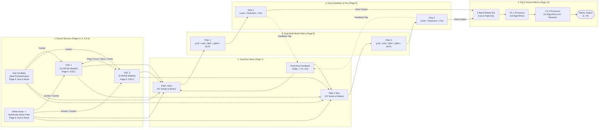

# Korg Z1 Voice & Effect Signal Flow

This diagram illustrates how audio and modulation flow through a Korg Z1 voice and where each stage is controlled on your Electra One mk2 preset.

---

## Following the Signal Path Across the 12 Pages

1. **Voice & Scale Setup ([Page 1: Utility](file:///home/timbos/src/Z1/usermanual/pages/01-base-utility.md) & [Page 2: Common & Arp](file:///home/timbos/src/Z1/usermanual/pages/11-common-arp.md))**:
   - Determines whether notes play Polyphonically, Monophonically, or stacked in Unison, applies Portamento glide, and maps each key through the selected temperament or custom 5-octave microtonal scale.
2. **Sound Generation ([Page 3: OSC Common](file:///home/timbos/src/Z1/usermanual/pages/03b-osc-common.md), [Page 4: OSC 1](file:///home/timbos/src/Z1/usermanual/pages/02-osc1.md), [Page 5: OSC 2](file:///home/timbos/src/Z1/usermanual/pages/03-osc2.md) & [Page 6: Sub, Noise & Common](file:///home/timbos/src/Z1/usermanual/pages/04-sub-noise.md))**:
   - **OSC 1** and **OSC 2** generate the primary timbres using any combination of the Z1's MOSS physical and digital synthesis algorithms. They can run independently or cross-interact via Ring Modulation, Cross Modulation, Hard Sync, or Comb Filtering.
   - **Sub OSC** adds sub-octave weight, while the **Noise Generator** passes through its own dedicated resonant **Noise Filter** before entering the mixer.
3. **Dual-Bus Mixing & Feedback ([Page 7: Mixer](file:///home/timbos/src/Z1/usermanual/pages/05-mixer.md))**:
   - Each of the 4 sources—plus a **Post-Amp Feedback** return—has independent send levels (`-> F1` and `-> F2`), modulation routings, and mute buttons feeding **Filter 1** and **Filter 2**.
4. **Dual Multi-Mode Filtering ([Page 8: Filters](file:///home/timbos/src/Z1/usermanual/pages/06-filter.md))**:
   - **Filter 1** shapes Bus 1 and **Filter 2** shapes Bus 2 in parallel. Each filter can operate in `LPF`, `HPF`, `BPF`, Dual-Formant `2BPF`, or `BYP` mode, or link their cutoff movements together via **Flt2 Link**.
5. **Amplification, Waveshaping Distortion & Stereo Pan ([Page 9: Amp & Mod](file:///home/timbos/src/Z1/usermanual/pages/09-amp-mod-pe.md))**:
   - **Amp 1** shapes Filter 1's output using **Amp 1 EG**, optional per-voice **Distortion**, and **Amp 1 Pan**.
   - **Amp 2** shapes Filter 2's output using **Amp 2 EG**, optional per-voice **Distortion**, and **Amp 2 Pan**.
6. **Modulation Sources ([Page 9: Performance Knobs](file:///home/timbos/src/Z1/usermanual/pages/09-amp-mod-pe.md), [Page 10: Envelopes](file:///home/timbos/src/Z1/usermanual/pages/07-envelopes.md) & [Page 11: LFO 1–4](file:///home/timbos/src/Z1/usermanual/pages/08-lfos.md))**:
   - **5 Multi-Stage Envelopes (`EG 1–4` & `Amp EG`)**, **4 LFOs (`LFO 1–4`)**, and **5 Multi-Target Performance Knobs (`PE Knob 1–5`)** can modulate pitch, oscillator parameters, mixer bus levels, filter cutoffs, amplifier levels, stereo panning, and effect depths throughout the voice.
7. **2-Band Master EQ & Dual Stereo Effects ([Page 12: FX & EQ](file:///home/timbos/src/Z1/usermanual/pages/10-effects-eq.md))**:
   - The combined stereo voice signal passes through the **2-Band Master EQ**, then into **FX 1** (15 algorithms) and **FX 2** (11 algorithms, or automatically merged when an FX1 double-size algorithm is active) before reaching the stereo outputs.
