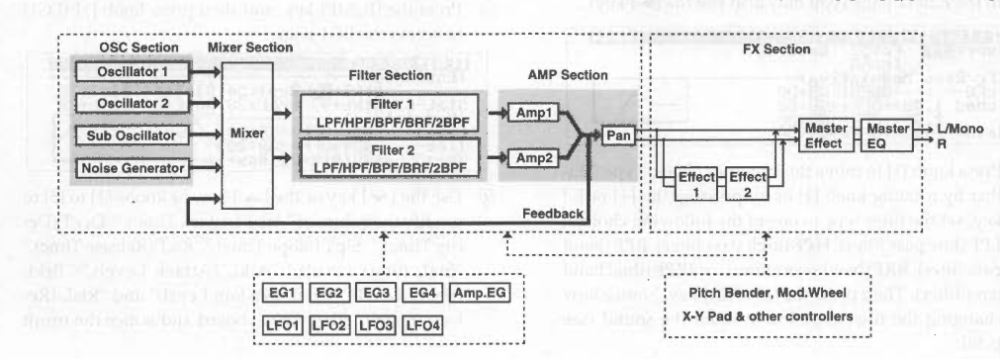
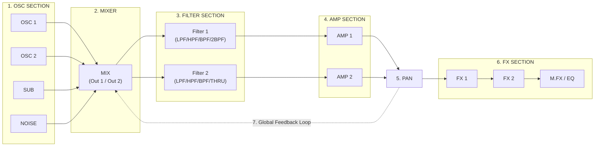

# Page 12 — Interactive Signal Flow Diagram & Routing Visualizer

[⬅ Back to User Manual Index](../README.md)

- **Source Folder:** [`e1/z1-signalflow/`](../../e1/z1-signalflow/)
- **Files:** [`README.md`](../../e1/z1-signalflow/README.md) | [`draw-signal-flow.lua`](../../e1/z1-signalflow/draw-signal-flow.lua) | [`signalflow.png`](../../e1/z1-signalflow/signalflow.png)

> 📸 **[Reference Diagram: `../../e1/z1-signalflow/signalflow.png`]**
> 
>
> 🎬 **[Video Placeholder: `../media/12-signal-flow.mp4`]**
> *Add short video showing the Signal Flow diagram updating when toggling OSC/Sub/Noise switches, Filter Serial/Parallel routing, and Feedback.*

---

## 1. Overview

The **Signal Flow Visualizer** ([`draw-signal-flow.lua`](../../e1/z1-signalflow/draw-signal-flow.lua)) renders a `508 × 152 px` graphical block diagram of the current Korg Z1 Program architecture directly on the Electra One mk2 screen.

---

## 2. Visualized Signal Path Blocks

### Dynamic Visual States
1. **OSC Section (`OSC 1`, `OSC 2`, `SUB`, `NOISE`):** Highlighted when the corresponding Mixer Output Switch (`IDs 254..257`) is `ON`; dimmed (`light grey`) when muted.
2. **Filter 1 & Filter 2 (`Serial` / `Parallel` / `Indiv`):** Displays the active filter topology and highlights the selected filter mode (`LPF24`, `LPF12`, `HPF`, `BPF`, `BRF`, `2BPF`, `THRU`).
3. **Amp 1 & Amp 2:** Reflects serial vs. parallel/individual routing from Filter 1 and Filter 2.
4. **Global Post-Amp Feedback Loop:** Drawn in amber along the bottom return path (`PAN` $\rightarrow$ `MIX`); solid when Feedback Out 1/2 (`ID 248` / `ID 251`) is active, dimmed when `0`.
5. **FX Chain (`FX1` $\rightarrow$ `FX2` $\rightarrow$ `M.EQ / Master FX`):** Highlights active effect processors and dims bypassed (`Off`) blocks.
